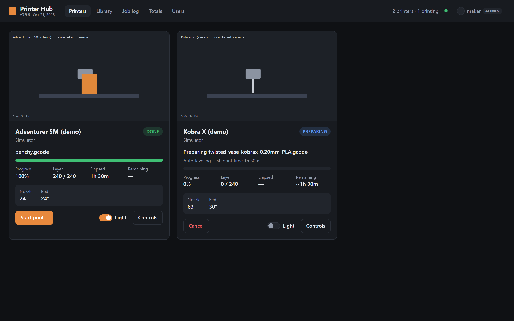
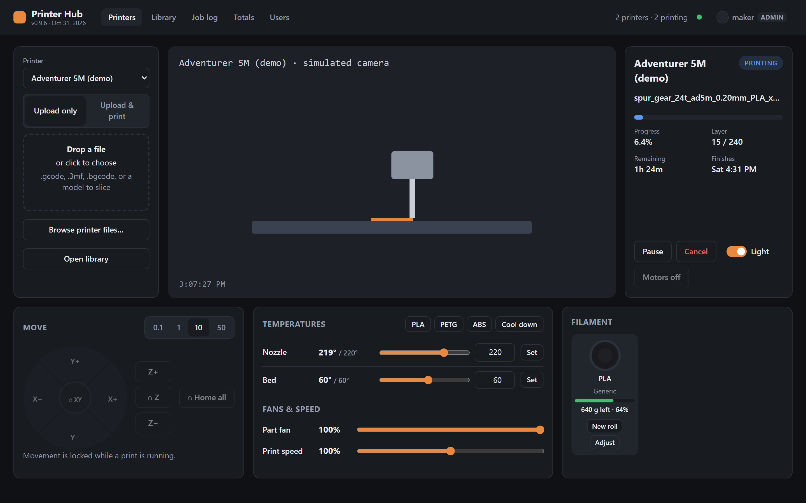
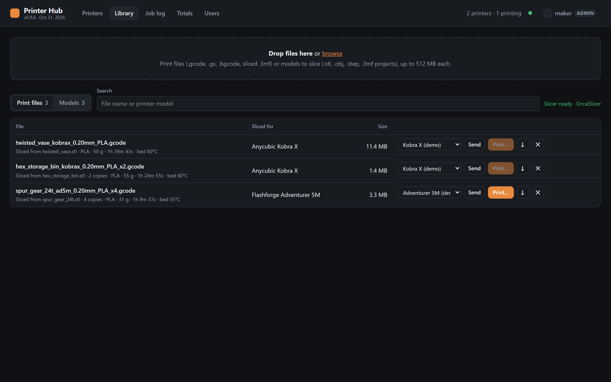
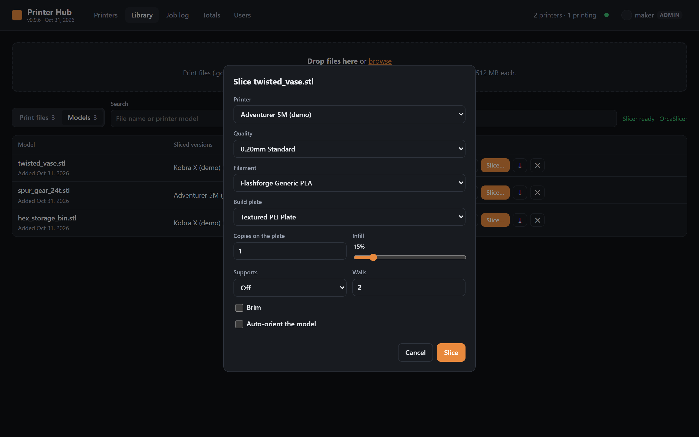
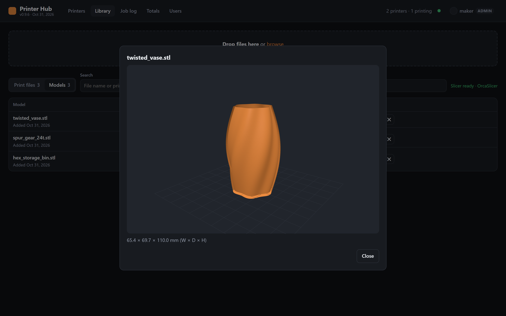
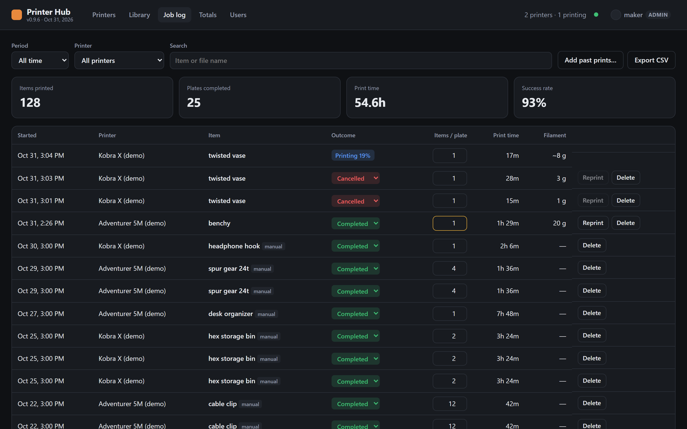
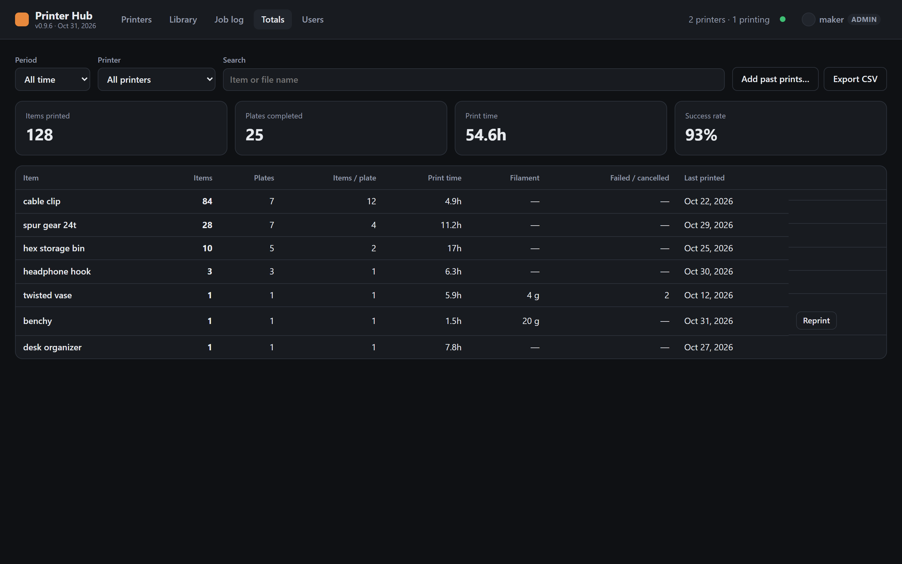
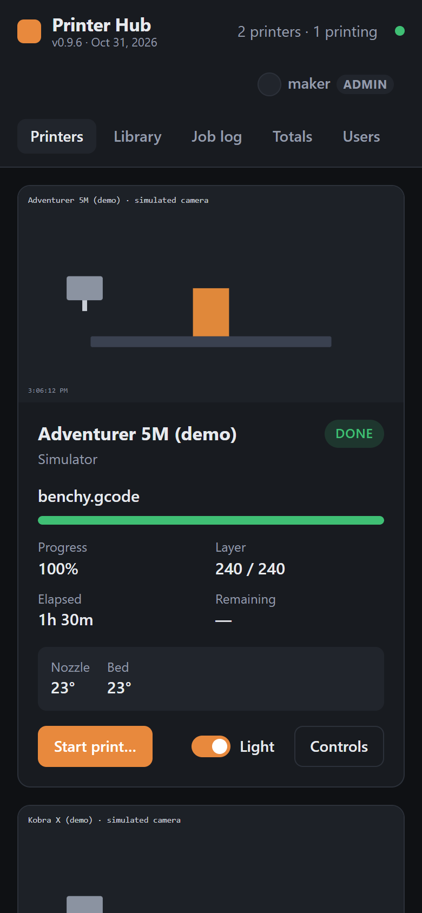

# Printer Hub

[](https://github.com/Shawman511/printer-hub/actions/workflows/slicer-build.yml)
[](LICENSE)

A self-hosted control room for your 3D printers on your own network. It
connects to stock-firmware **FlashForge Adventurer 5M** and **Anycubic Kobra X**
printers directly, with no vendor cloud. It shows them all in one place:
live status and cameras, full manual control, a file library with a built-in
OrcaSlicer, a print job log, and filament tracking.



## Features

- **Live dashboard:** status, progress, layers, time remaining, temperatures
  and camera for every printer, pushed to the browser as it changes. Printers
  getting ready (file check, leveling, heating) show what they're preparing
  and the estimated print time.
- **Control panel:** pause, resume, cancel, light, jog and home, nozzle and
  bed temperatures with presets, fan and speed, all checked against safety
  limits on the server.
- **Library and slicing:** keep G-code and models on the hub. Slice STL, OBJ,
  3MF and STEP files with OrcaSlicer's own profiles for each printer, preview
  models in 3D, and send them to a printer in one step. Files sliced for a
  different printer are refused before they reach it.
- **Multi-color:** map a file's colors to the Kobra X's ACE slots, with a
  suggested match by material and color.
- **Filament rolls:** tracks how much is left on each roll from what each
  print used.
- **Job log and totals:** every print is logged automatically, with items per
  plate, print hours, success rate and CSV export.
- **Sign-in and roles:** admin, operator and watch-only viewer accounts.
- **Works on a phone:** the same app, laid out for small screens.

| | |
| --- | --- |
|  |  |
| **Control panel:** camera, motion, temperatures, fans and filament | **Library:** print files with the printer and settings they were sliced for |
|  |  |
| **Slice:** OrcaSlicer profiles, copies, infill, supports, walls | **Preview:** 3D view with dimensions |
|  |  |
| **Job log:** every print, outcome, items and filament | **Totals:** items, plates and hours per model |

<p align="center"></p>

### Supported printers

| Printer | Type | How it connects |
| --- | --- | --- |
| FlashForge Adventurer 5M / 5M Pro | `flashforge` | Local HTTP API (port 8898) with serial + check code; falls back to the G-code TCP API (port 8899) if no check code is set |
| Anycubic Kobra X / Kobra 3 / S1 | `anycubic` | Stock-firmware **LAN Mode**: signed handshake on port 18910, then MQTT over TLS (port 9883) |
| Simulator | `mock` | For trying the UI with no hardware |

Other printers can be added as a driver (see [How it works](#how-it-works)).
Only the Adventurer 5M and Kobra X have been tested on real hardware.

## Try it

You need Node.js 18 or newer. The demo runs two simulated printers, so no
hardware is needed:

```bash
npm install
npm run demo
```

Open http://localhost:3000. On first run the terminal prints a one-time
**setup code**; enter it to create your admin account.

With real printers, `npm start` uses `config.json` (created from
`config.example.json` on first run; see [Configure](#configure-configjson)).
Any device on your network can then use `http://<this-pc-ip>:3000`. Slicing
needs the `slicer` container, so for the full app use Docker (below).

## Run with Docker / Dockhand

`compose.yaml` builds the image from this repo and keeps the job log in the
`printer-hub-data` volume. Printer settings come from environment variables
(see `.env.example`), which `config.docker.json` reads as `${NAME}`. That keeps
the check code out of git.

```bash
cp .env.example .env   # fill in AD5M_SERIAL / AD5M_CHECK_CODE
docker compose up -d --build
```

**Dockhand:** add this repository as a Git stack, point it at `compose.yaml`
on `main`, and set `AD5M_HOST`, `AD5M_SERIAL`, `AD5M_CHECK_CODE` and
`KOBRAX_HOST` as stack environment variables. `pull_policy: build` makes
every redeploy rebuild from the new commit. Add Dockhand's webhook to the
GitHub repo to redeploy on push.

The Docker host has to be able to reach both printers' IPs. If they're on
other VLANs, the host's routing or firewall has to allow it.

**Which version is running:** the top bar shows it under the name (e.g.
`v0.9 · Oct 31, 2026`), from `version` and `released` in `package.json`; bump
both with each change. Hover it for the slicer's OrcaSlicer version and
whether its image can slice STEP files.

## Sign-in and users

The hub controls real printers, so every page and API call needs a signed-in
user. Only the sign-in page and `/api/health` are open.

- **First run:** the hub prints a one-time **setup code** in its log. In
  Dockhand, open the printer-hub container's logs and look for
  `*** First run: ... setup code XXXXX-XXXXX`. Open the hub, enter the code,
  and create the admin account. After that, the code is gone.
- **Users** (admins only) adds accounts with one of three roles:
  - **Admin**: everything, including managing users.
  - **Operator**: print, control printers, manage files, rolls and the job log.
  - **Viewer**: watch status, cameras and logs. Every change is refused.
- **Account** (your name, top right): change your password, see the devices
  you're signed in on, and sign them out.
- Sessions last 30 days and renew as you use them. Untick *Keep me signed in*
  for a session that ends when the browser closes, or after 12 hours.
- Changing or resetting a password signs that user out everywhere else.
  Deleting a user ends their sessions and live view at once.
- Eight wrong passwords lock that username and that address out for 15 minutes.
- **Forgot the admin password:** set `HUB_RESET_PASSWORD=<username>` in the
  stack env and redeploy. The log shows a new random password. Sign in, change
  it, then remove the variable.

Passwords are stored as scrypt hashes and sessions as SHA-256 hashes of their
tokens, in `data/auth.json`. The session cookie is HttpOnly and SameSite=Lax,
and changes from other sites are refused (Origin check). If you put the hub
behind an HTTPS reverse proxy, the cookie gets the Secure flag from
`X-Forwarded-Proto`. Set `"trustProxy": true` in the config so failed
sign-ins are counted per real client address.

## Configure `config.json`

```json
{
  "port": 3000,
  "pollIntervalMs": 3000,
  "printers": [
    { "id": "ad5m", "name": "Adventurer 5M", "type": "flashforge",
      "host": "192.168.1.50", "serialNumber": "SNMOMC9900001", "checkCode": "a1b2c3d4" },
    { "id": "kobrax", "name": "Kobra X", "type": "anycubic", "host": "192.168.1.51" }
  ]
}
```

Give both printers a DHCP reservation in your router so the IPs don't change.

### FlashForge AD5M

- On the printer's touchscreen, turn on **LAN-only mode** in the network
  settings. The screen then shows a **check code**. The serial number is under
  the About / device info screen.
- With `serialNumber` + `checkCode` you get everything: full status, light
  control, file list, and starting prints.
- Without them, the hub uses the older TCP API: status, progress, temps, and
  pause/resume/cancel still work. Light and file list don't. That port only
  allows one client at a time, so it can clash with FlashPrint or Orca.
- Camera: `http://<ip>:8080/?action=stream` (standard on the 5M Pro; an add-on
  for the 5M). Override with `"cameraUrl": "..."`, or turn it off with
  `"cameraUrl": false`.
- Optional: `"levelBeforePrint": true` runs auto-leveling before prints you start from the hub.

### Anycubic Kobra X

- Turn on **LAN Mode** on the printer (Settings → Network). In cloud mode the
  hub reports "Printer is in cloud mode".
- No credentials to enter. The hub gets them from the printer during the
  handshake and does a fresh handshake each time it reconnects.
- The Kobra X only has WiFi. If you want it fully local, you can block its
  internet access in your router once LAN Mode is on.
- Camera: the printer serves an FLV stream on `:18088/flv`. The hub sends it
  a start-camera command and plays the stream with mpegts.js. If the stream
  fails, it falls back to still snapshots.

## Control panel

**Controls** on a printer card opens `#control/<printer>`, a full-page view of
that printer:

- **Files:** upload only, or upload & print (models go to the slicer).
  Browse printer files.
- **Camera** at full size.
- **Status:** progress, layer, time remaining, and the clock time it will
  finish. Pause, resume, cancel, light, and motors off.
- **Move:** XY jog pad, Z up/down, step size 0.1 / 1 / 10 / 50 mm, and home XY,
  Z or all.
- **Temperatures:** nozzle and bed targets (slider or number), plus PLA, PETG
  and ABS preheat presets and Cool down. Max 280/110 °C on the AD5M and
  300/120 °C on the Kobra X.
- **Fans & speed:** part fan %. During a print: AD5M speed 50–150%, or the
  Kobra X's Silent / Standard / Sport modes.
- **Filament:** each Kobra X ACE slot, or the AD5M's single spool, shows a
  hub-tracked roll. See below.

### Filament rolls

The printers don't really measure what's left (the Kobra X reports 100% for
every slot), so the hub tracks rolls itself:

- **New roll** on a slot records a roll's size (1 kg by default), material and
  color. For a part-used roll, enter how many grams are left.
- Each print's filament is charged to the slot(s) it used:
  - Kobra X prints started from the hub: the file's per-color grams and the
    slot mapping you chose.
  - Kobra X prints started elsewhere: the file's per-color grams, with the
    slots guessed the same way the print dialog suggests them.
  - AD5M: the file's weight from the library, or the printer's own estimate.

  Cancelled or failed prints are charged by how far they got.
- Remaining = the roll's starting weight minus the filament charged since. It's
  recalculated from the job log, so fixing a job's outcome corrects the roll.
- **Adjust** sets the remaining grams after weighing a roll (subtract the empty
  spool, usually 200–250 g). Rolls are stored in `data/spools.json`.
- The job log and Totals gain a Filament column, and the CSV gets `filament_g`.

Safety: jog, home and motors off are refused while a print is running. The
server enforces every limit, not just the UI.

Protocols: the AD5M takes G-code over its TCP API (`G91`/`G1` jog, `G28`,
`M104`/`M140`, `M106`, `M18`) and `printerCtl_cmd` for speed. The Kobra X takes
MQTT `axis/move`, `axis/turnOff`, `tempature/set`, `fan/setSpeed` and
`print/update`.

## Files: library, uploads and starting prints

- **Library tab:** drop `.gcode`, `.gx`, `.3mf` or `.bgcode` files (up to 512 MB)
  to store them on the hub, in `data/library/` (the `printer-hub-data` volume in
  Docker). The hub reads the slicer header to show which printer and material
  each file was sliced for, and suggests a matching printer. **Send** copies the
  file to a printer. **Print…** sends it if needed, then opens the print dialog.
- **Start print… → Upload from computer:** uploads straight to that printer
  and keeps a copy in the library. With **Print after upload** on, the print
  dialog opens right after.
- **Print dialog:** on the Kobra X, each color in the file is mapped to an ACE
  slot. The default is the loaded slot with the same material and the closest
  color, and you can change it. Both printers have an auto-level option.
- **Reprint** in the job log opens the same dialog. If the file is gone from
  the printer but still in the library, it offers to send it again.

Kobra X uploads and starts follow the format validated on firmware 2.0.2.2
by [kobra-lan-cli](https://github.com/eduardobittencourt/kobra-lan-cli). The
printer must be idle to receive files.

## Models and slicing

- **Library → Models:** drop `.stl`, `.obj`, `.step`/`.stp`, `.amf` or a
  `.3mf` project. A `.3mf` that already contains sliced plates goes to Print
  files instead. STL, OBJ and 3MF models get a 3D **Preview** with dimensions.
- **Slice…** runs [OrcaSlicer](https://github.com/SoftFever/OrcaSlicer)
  (2.4.2 by default) in the `slicer` container, using Orca's own 0.4 mm presets:
  - AD5M: `Flashforge Adventurer 5M 0.4 Nozzle`, with 0.12 Fine, 0.20 Standard or
    0.24 Draft quality and all Flashforge AD5M filaments.
  - Kobra X: `Anycubic Kobra X 0.4 nozzle`, with 0.08–0.28 mm quality and the
    Anycubic Kobra X filaments.
  - STEP files are meshed to STL first with OpenCASCADE (`slicer/step2stl.cpp`,
    same tolerances as Orca's desktop app), since Orca's CLI can't read STEP.

  You can set copies on the plate (they're auto-arranged), infill, supports
  (off, normal or tree), walls, brim and auto-orient. The dialog remembers your
  last choices for each printer.
- The result lands in Print files, linked to its model. The copy count becomes
  the job's **items per plate**, so 4 copies counts as 4 items in Totals.
  **Send & print…** goes straight to the print dialog.
- Kobra X slices get a `; paint_info` header line (Anycubic Slicer Next writes
  one; Orca doesn't), so the printer can report the file's color for slot mapping.
- The slicer flattens Orca's `inherits` chains into standalone presets and fixes
  one Kobra X profile value the command-line tool rejects (cut retraction 0,
  while that feature is off). Set a different Orca version with
  `ORCA_VERSION` in the stack env.
- Multi-color painting and placing parts by hand still need a desktop slicer.

## Job log and totals

While the hub is running, it logs every print by itself: start, finish and
outcome (completed, cancelled or failed), the file name, and print time. Jobs
are saved in `data/jobs.json`.

- **Items per plate:** type how many items a plate makes into any of its jobs
  (e.g. `4`). That number becomes the default for the model, so every
  later reprint counts 4. Earlier jobs of that model that never got a
  count are filled in too.
- **Grouping:** re-slices of the same model count together. The slicer's date
  prefix, filament, layer height and time suffix are stripped, so
  `1024-1448-Bracket_plate(01)_PLA_0.2_11h0m.gcode` and
  `1021-0900-Bracket_plate(01)_PLA_0.2_11h2m.gcode` both count as **Bracket**.
- **Totals** shows items, plates, print hours and failures per model, with
  filters for period (today, 7 days, 30 days, month, year), printer, and a search box.
- **Reprint** starts the same file on the same printer. The button is
  enabled when that printer is idle.
- **Add past prints…** back-fills prints made before the hub was logging
  (plates × items per plate, hours per plate, date).
- **Export CSV** downloads the whole log.
- Prints made while the hub isn't running aren't seen. If the hub restarts
  mid-print, the job is still logged when the print finishes; if the print
  ended while the hub was down, the job shows as **Unknown** and you can set
  its outcome by hand.

## How it works

- `server.js` polls or subscribes to each printer and pushes changes to the
  browser over Server-Sent Events (`/api/events`).
- Camera and thumbnail traffic goes through the server
  (`/api/printers/:id/camera`), so the browser only ever talks to port 3000.
- Drivers live in `drivers/`, one file per printer brand. To add a brand,
  extend `PrinterDriver` in `drivers/base.js`.

API (needs a session cookie from `POST /api/auth/login`): `GET /api/printers`, `GET /api/printers/:id/files`,
`POST /api/printers/:id/{pause|resume|cancel}`,
`POST /api/printers/:id/light {"on":true}`, `POST /api/printers/:id/print {"file":"x.gcode"}`.

Even with sign-in, keep the hub on your home network or behind a VPN. Don't
port-forward it to the internet.

## Contributing

Issues and pull requests are welcome. `npm run demo` gives you a full UI with
simulated printers. Changes to `slicer/` are checked by the
[slicer-build](.github/workflows/slicer-build.yml) workflow, which builds the
image, runs its self-test and slices a real STEP file.

To report a security problem, see [SECURITY.md](SECURITY.md).

## Disclaimer

Printer Hub controls real heaters and motors. Don't leave printers
unattended because the hub says a print is going well, and stay within
your printer's own limits. It talks to the printers' local APIs, which their
makers don't document, so a firmware update can change or break things.

This is an independent project. It isn't affiliated with or endorsed by
FlashForge, Anycubic or the OrcaSlicer project. Product names are trademarks
of their owners.

## License

[MIT](LICENSE). The slicer image downloads [OrcaSlicer](https://github.com/SoftFever/OrcaSlicer)
(AGPL-3.0) and installs [Open CASCADE Technology](https://dev.opencascade.org/)
(LGPL-2.1) from Ubuntu at build time; neither is included in this repository.
