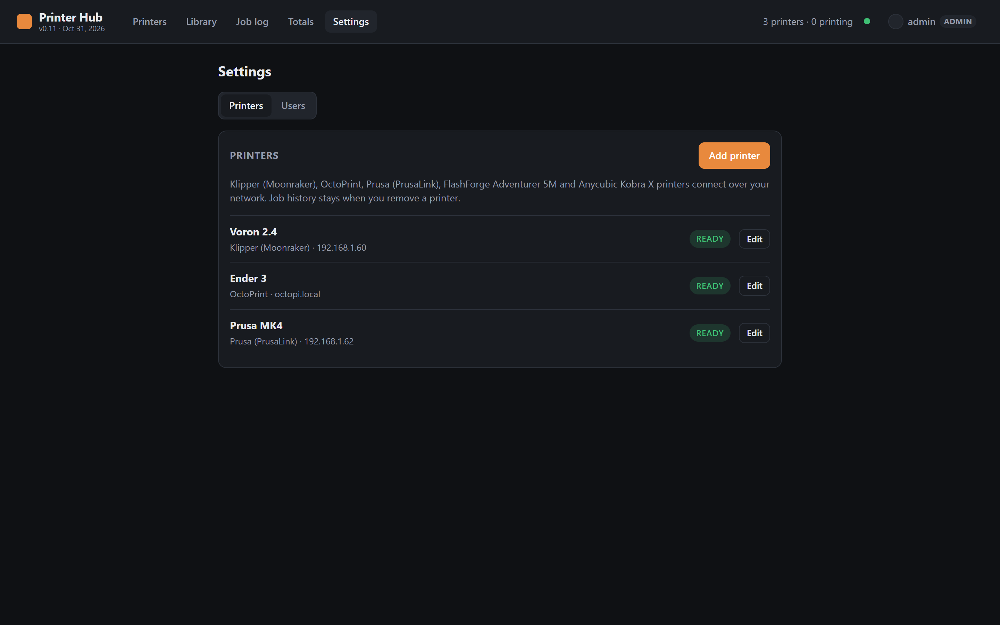
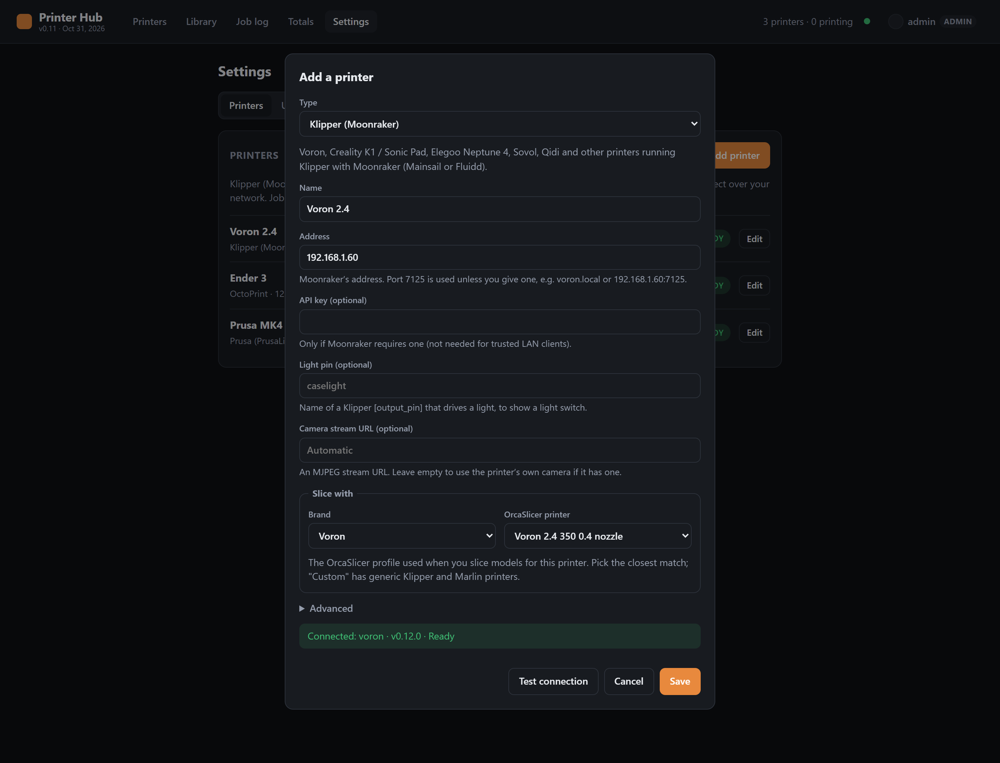

# Printer Hub

[](https://github.com/Shawman511/printer-hub/actions/workflows/ci.yml)
[](https://github.com/Shawman511/printer-hub/actions/workflows/slicer-build.yml)
[](LICENSE)

A self-hosted control room for your 3D printers, on your own network and with
no vendor cloud. Add your **Klipper**, **OctoPrint**, **Prusa**, **FlashForge**
or **Anycubic** printers and see them all in one place: live status and
cameras, manual control, a file library with a built-in OrcaSlicer, a print
job log, and filament tracking.


## Features

- **Live dashboard:** status, progress, layers, time remaining, temperatures
  and camera for every printer, pushed to the browser as it changes. Printers
  getting ready (file check, leveling, heating) show what they're preparing
  and the estimated print time.
- **Control panel:** pause, resume, cancel, light, jog and home, nozzle and
  bed temperatures with presets, fan and speed, all checked against safety
  limits on the server.
- **Library and slicing:** keep G-code and models on the hub. Slice STL, OBJ,
  3MF and STEP files with OrcaSlicer's profiles for your printer (about a
  thousand printers from 64 brands), preview models in 3D, and send them to a
  printer in one step. Files sliced for a different printer are refused before
  they reach it.
- **Multi-color:** map a file's colors to the Kobra X's ACE slots, with a
  suggested match by material and color.
- **Filament rolls:** tracks how much is left on each roll from what each
  print used.
- **Job log and totals:** every print is logged automatically, with items per
  plate, print hours, success rate and CSV export.
- **Set up in the browser:** add printers, test the connection and pick the
  slicer profile under Settings. Sign-in with admin, operator and watch-only
  viewer accounts.
- **Works on a phone:** the same app, laid out for small screens.

| | |
| --- | --- |
|  |  |
| **Control panel:** camera, motion, temperatures, fans and filament | **Library:** print files with the printer and settings they were sliced for |
|  |  |
| **Slice:** OrcaSlicer profiles, copies, infill, supports, walls | **Preview:** 3D view with dimensions |
|  |  |
| **Job log:** every print, outcome, items and filament | **Totals:** items, plates and hours per model |
|  |  |
| **Settings:** your printers and their status | **Add a printer:** type, address, slicer profile, connection test |

<p align="center"></p>

## Supported printers

| Type in Settings | Printers | Status | Control | Start prints | Camera |
| --- | --- | --- | --- | --- | --- |
| **Klipper (Moonraker)** | Voron, Creality K1 / Sonic Pad, Elegoo Neptune 4, Sovol, Qidi, RatRig and other Klipper printers with Mainsail or Fluidd | ✓ | ✓ | ✓ | ✓ (Moonraker webcams) |
| **OctoPrint** | Any printer connected to OctoPrint / OctoPi (Creality Ender, Prusa MK3, most Marlin printers) | ✓ | ✓ | ✓ | ✓ (OctoPrint webcam) |
| **Prusa (PrusaLink)** | Prusa MK4/S, MK3.9, XL, MINI+, Core One | ✓ | pause / resume / cancel | ✓ | stream URL only |
| **FlashForge Adventurer 5M / 5M Pro** | Stock firmware, LAN-only mode | ✓ | ✓ | ✓ | ✓ |
| **Anycubic Kobra X / Kobra 3 / S1** | Stock firmware, LAN Mode (incl. ACE multi-color) | ✓ | ✓ | ✓ | ✓ |
| **Simulator** | A pretend printer for trying the hub | ✓ | ✓ | ✓ | ✓ |

The FlashForge and Anycubic drivers are used daily on real printers. The
Klipper, OctoPrint and PrusaLink drivers follow those projects' documented
APIs and are tested against simulated servers in [`test/`](test/), but haven't
been run against every model. If something doesn't work with yours, please
[open an issue](https://github.com/Shawman511/printer-hub/issues).

Not supported yet: Bambu Lab, Elegoo Centauri (SDCP) and Creality printers on
stock (non-Klipper) firmware. Adding a printer type is one file in
[`drivers/`](drivers/); see [How it works](#how-it-works).

## Install

You need a machine on the same network as your printers that runs Docker, e.g.
a small server, a NAS, or a Raspberry Pi.

### With Docker (recommended)

```bash
mkdir printer-hub && cd printer-hub
curl -fsSLO https://raw.githubusercontent.com/Shawman511/printer-hub/main/deploy/docker-compose.yml
docker compose up -d
```

Then:

1. Open `http://<that machine's IP>:3000`.
2. Get the one-time **setup code** from the log and create your admin account:
   `docker compose logs printer-hub | grep "setup code"`
3. Click **Add a printer** and follow [Add your printers](#add-your-printers).

This runs two containers: the hub, and the OrcaSlicer service for slicing.
Data (accounts, printers, library, job log) lives in the `printer-hub-data`
volume. To update: `docker compose pull && docker compose up -d`.

**Raspberry Pi / ARM:** the hub image runs on ARM, but OrcaSlicer only ships
x86-64 Linux builds. Remove the `slicer` service (and `SLICER_URL`) from the
compose file; everything except slicing works, and you can still upload
G-code you sliced on your computer.

**Docker UIs** (Portainer, Dockhand, Unraid, …): create a stack from
`deploy/docker-compose.yml`, or point a Git stack at this repository's
`compose.yaml` to build from source on each update.

### From source

```bash
git clone https://github.com/Shawman511/printer-hub.git
cd printer-hub
docker compose up -d --build   # hub + slicer, built locally
```

Or without Docker (Node.js 18+, no slicing):

```bash
npm install
npm start        # your printers
npm run demo     # or two simulated printers, no hardware needed
```

Run the tests with `npm test`.

## Add your printers

Admins add printers under **Settings → Printers → Add printer**:

1. **Type:** pick how the printer is reached (table above).
2. **Name** and **Address:** the printer's IP address or host name. Give it a
   DHCP reservation in your router so the address doesn't change.
3. The type's own settings (below).
4. **Slice with:** the OrcaSlicer profile used when you slice models for this
   printer: its brand, then the model and nozzle. For a printer that isn't
   listed, **Custom** has generic Klipper and Marlin profiles.
5. **Test connection**, then **Save**. The printer shows up on the dashboard
   right away.

Passwords and keys are stored on the server (`data/printers.json` in the data
volume) and never sent back to the browser. Removing a printer keeps its job
history.

**Klipper (Moonraker):** use Moonraker's address; port 7125 is assumed unless
you give one (e.g. `voron.local` or `192.168.1.60:7125`). An API key is only
needed if Moonraker doesn't trust your hub's network (`[authorization]`
`trusted_clients`). The camera comes from Moonraker's webcam settings. For a
light switch, enter the name of the `[output_pin]` that drives your light.

**OctoPrint:** use OctoPrint's address (e.g. `octopi.local`, or a full URL such
as `http://192.168.1.70:5000`), and an API key from OctoPrint's
*Settings → Application Keys*. The camera comes from OctoPrint's webcam
settings. OctoPrint must be connected to the printer.

**Prusa (PrusaLink):** turn on PrusaLink on the printer. The address and
password are on its screen under *Settings → Network*; the username is `maker`.
Older firmware shows an API key instead of a password. Prusa printers have no
local camera stream, but you can enter one (e.g. a webcam on a Pi).

**FlashForge Adventurer 5M / 5M Pro:** on the printer's screen, turn on
**LAN-only mode** in the network settings; it then shows a **check code**. The
serial number is under About / device info. With both you get everything
(status, light, files, starting prints). Without them, status, progress, temps
and pause/resume/cancel still work over the older TCP API, which allows one
client at a time, so it can clash with FlashPrint or Orca. The camera is
`http://<ip>:8080/?action=stream` (standard on the 5M Pro; an add-on for the
5M).

**Anycubic Kobra X / Kobra 3 / S1:** turn on **LAN Mode** (Settings →
Network). There are no credentials to enter: the hub gets them from the
printer. In cloud mode the hub reports "Printer is in cloud mode". The Kobra X
only has WiFi; once LAN Mode is on you can block its internet access in your
router. The camera is the printer's FLV stream, with still snapshots as a
fallback.

The machine running the hub has to reach the printers' addresses. If they're
on another VLAN, your router or firewall has to allow it.

## Sign-in and users

The hub controls real printers, so every page and API call needs a signed-in
user. Only the sign-in page and `/api/health` are open.

- **First run:** the hub prints a one-time **setup code** in its log
  (`*** First run: ... setup code XXXXX-XXXXX`; with Docker,
  `docker compose logs printer-hub`). Open the hub, enter the code, and create
  the admin account. After that, the code is gone.
- **Settings → Users** (admins only) adds accounts with one of three roles:
  - **Admin**: everything, including printers and users.
  - **Operator**: print, control printers, manage files, rolls and the job log.
  - **Viewer**: watch status, cameras and logs. Every change is refused.
- **Account** (your name, top right): change your password, see the devices
  you're signed in on, and sign them out.
- Sessions last 30 days and renew as you use them. Untick *Keep me signed in*
  for a session that ends when the browser closes, or after 12 hours.
- Changing or resetting a password signs that user out everywhere else.
  Deleting a user ends their sessions and live view at once.
- Eight wrong passwords lock that username and that address out for 15 minutes.
- **Forgot the admin password:** set the environment variable
  `HUB_RESET_PASSWORD=<username>` on the hub container and restart it. The log shows a new random password. Sign in, change
  it, then remove the variable.

Passwords are stored as scrypt hashes and sessions as SHA-256 hashes of their
tokens, in `data/auth.json`. The session cookie is HttpOnly and SameSite=Lax,
and changes from other sites are refused (Origin check). If you put the hub
behind an HTTPS reverse proxy, the cookie gets the Secure flag from
`X-Forwarded-Proto`. Set `"trustProxy": true` in the config so failed
sign-ins are counted per real client address.

## Advanced: the config file

Most setups need nothing here. The hub reads `config.json` (or the file named
by `CONFIG_PATH`; the Docker image uses `config.docker.json`):

```json
{ "port": 3000, "pollIntervalMs": 3000, "trustProxy": false, "printers": [] }
```

- `pollIntervalMs`: how often printers are asked for their status.
- `trustProxy`: set to `true` behind a reverse proxy (see above).
- `printers`: printers listed here are imported into Settings on the very
  first start (then `data/printers.json` takes over). Values like
  `"${NAME}"` are read from environment variables. Each entry has `id`,
  `name`, `type` (`moonraker`, `octoprint`, `prusalink`, `flashforge`,
  `anycubic`, `mock`) and that type's settings, e.g.
  `{ "id": "voron", "name": "Voron", "type": "moonraker", "host": "192.168.1.60" }`.

Environment variables: `PORT`, `DATA_DIR`, `SLICER_URL`, `CONFIG_PATH`,
`TZ`, `HUB_RESET_PASSWORD`.

**Which version is running:** the top bar shows it under the name (e.g.
`v0.11 · Nov 1, 2026`), from `version` and `released` in `package.json`.
Hover it for the slicer's OrcaSlicer version and whether it can slice STEP
files.

## Control panel

**Controls** on a printer card opens `#control/<printer>`, a full-page view of
that printer:

- **Files:** upload only, or upload & print (models go to the slicer).
  Browse printer files.
- **Camera** at full size.
- **Status:** progress, layer, time remaining, and the clock time it will
  finish. Pause, resume, cancel, light, and motors off.
- **Move:** XY jog pad, Z up/down, step size 0.1 / 1 / 10 / 50 mm, and home XY,
  Z or all.
- **Temperatures:** nozzle and bed targets (slider or number), plus PLA, PETG
  and ABS preheat presets and Cool down. Max 280/110 °C on the AD5M and
  300/120 °C on the Kobra X.
- **Fans & speed:** part fan %. During a print: AD5M speed 50–150%, or the
  Kobra X's Silent / Standard / Sport modes.
- **Filament:** each Kobra X ACE slot, or the AD5M's single spool, shows a
  hub-tracked roll. See below.

### Filament rolls

The printers don't really measure what's left (the Kobra X reports 100% for
every slot), so the hub tracks rolls itself:

- **New roll** on a slot records a roll's size (1 kg by default), material and
  color. For a part-used roll, enter how many grams are left.
- Each print's filament is charged to the slot(s) it used:
  - Kobra X prints started from the hub: the file's per-color grams and the
    slot mapping you chose.
  - Kobra X prints started elsewhere: the file's per-color grams, with the
    slots guessed the same way the print dialog suggests them.
  - AD5M: the file's weight from the library, or the printer's own estimate.

  Cancelled or failed prints are charged by how far they got.
- Remaining = the roll's starting weight minus the filament charged since. It's
  recalculated from the job log, so fixing a job's outcome corrects the roll.
- **Adjust** sets the remaining grams after weighing a roll (subtract the empty
  spool, usually 200–250 g). Rolls are stored in `data/spools.json`.
- The job log and Totals gain a Filament column, and the CSV gets `filament_g`.

Safety: jog, home and motors off are refused while a print is running. The
server enforces every limit, not just the UI.

Protocols: the AD5M takes G-code over its TCP API (`G91`/`G1` jog, `G28`,
`M104`/`M140`, `M106`, `M18`) and `printerCtl_cmd` for speed. The Kobra X takes
MQTT `axis/move`, `axis/turnOff`, `tempature/set`, `fan/setSpeed` and
`print/update`.

## Files: library, uploads and starting prints

- **Library tab:** drop `.gcode`, `.gx`, `.3mf` or `.bgcode` files (up to 512 MB)
  to store them on the hub, in `data/library/` (the `printer-hub-data` volume in
  Docker). The hub reads the slicer header to show which printer and material
  each file was sliced for, and suggests a matching printer. **Send** copies the
  file to a printer. **Print…** sends it if needed, then opens the print dialog.
- **Start print… → Upload from computer:** uploads straight to that printer
  and keeps a copy in the library. With **Print after upload** on, the print
  dialog opens right after.
- **Print dialog:** on the Kobra X, each color in the file is mapped to an ACE
  slot. The default is the loaded slot with the same material and the closest
  color, and you can change it. Both printers have an auto-level option.
- **Reprint** in the job log opens the same dialog. If the file is gone from
  the printer but still in the library, it offers to send it again.

Kobra X uploads and starts follow the format validated on firmware 2.0.2.2
by [kobra-lan-cli](https://github.com/eduardobittencourt/kobra-lan-cli). The
printer must be idle to receive files.

## Models and slicing

- **Library → Models:** drop `.stl`, `.obj`, `.step`/`.stp`, `.amf` or a
  `.3mf` project. A `.3mf` that already contains sliced plates goes to Print
  files instead. STL, OBJ and 3MF models get a 3D **Preview** with dimensions.
- **Slice…** runs [OrcaSlicer](https://github.com/SoftFever/OrcaSlicer)
  (2.4.2 by default) in the `slicer` container, with the printer's profile from
  Settings (FlashForge and Anycubic printers have one preset):
  - Quality and filament lists are Orca's presets for that printer. Brands
    without their own filaments (Voron, Custom, …) get Orca's generic filament
    library.
  - The build plate defaults to the printer's own, or else the plate the
    filament has temperatures for (e.g. smooth PEI on Prusa), so beds heat
    properly.
  - STEP files are meshed to STL first with OpenCASCADE (`slicer/step2stl.cpp`,
    same tolerances as Orca's desktop app), since Orca's CLI can't read STEP.

  You can set copies on the plate (they're auto-arranged), infill, supports
  (off, normal or tree), walls, brim and auto-orient. The dialog remembers your
  last choices for each printer.
- The result lands in Print files, linked to its model. The copy count becomes
  the job's **items per plate**, so 4 copies counts as 4 items in Totals.
  **Send & print…** goes straight to the print dialog.
- Kobra X slices get a `; paint_info` header line (Anycubic Slicer Next writes
  one; Orca doesn't), so the printer can report the file's color for slot mapping.
- The slicer flattens Orca's `inherits` chains into standalone presets and fixes
  one Kobra X profile value the command-line tool rejects (cut retraction 0,
  while that feature is off). Set a different Orca version with
  `ORCA_VERSION` in the stack env.
- Multi-color painting and placing parts by hand still need a desktop slicer.

## Job log and totals

While the hub is running, it logs every print by itself: start, finish and
outcome (completed, cancelled or failed), the file name, and print time. Jobs
are saved in `data/jobs.json`.

- **Items per plate:** type how many items a plate makes into any of its jobs
  (e.g. `4`). That number becomes the default for the model, so every
  later reprint counts 4. Earlier jobs of that model that never got a
  count are filled in too.
- **Grouping:** re-slices of the same model count together. The slicer's date
  prefix, filament, layer height and time suffix are stripped, so
  `1024-1448-Bracket_plate(01)_PLA_0.2_11h0m.gcode` and
  `1021-0900-Bracket_plate(01)_PLA_0.2_11h2m.gcode` both count as **Bracket**.
- **Totals** shows items, plates, print hours and failures per model, with
  filters for period (today, 7 days, 30 days, month, year), printer, and a search box.
- **Reprint** starts the same file on the same printer. The button is
  enabled when that printer is idle.
- **Add past prints…** back-fills prints made before the hub was logging
  (plates × items per plate, hours per plate, date).
- **Export CSV** downloads the whole log.
- Prints made while the hub isn't running aren't seen. If the hub restarts
  mid-print, the job is still logged when the print finishes; if the print
  ended while the hub was down, the job shows as **Unknown** and you can set
  its outcome by hand.

## How it works

- `server.js` polls or subscribes to each printer and pushes changes to the
  browser over Server-Sent Events (`/api/events`).
- Camera and thumbnail traffic goes through the server
  (`/api/printers/:id/camera`), so the browser only ever talks to port 3000.
- Printers are stored in `data/printers.json` and edited in Settings; each
  runs a driver from `drivers/`, one file per printer type.
- **Adding a printer type:** extend `PrinterDriver` (`drivers/base.js`), give
  the class a `static meta` (label, help and the setup form's fields), and add
  it to `DRIVERS` in `server.js`. The Settings form, secret handling and
  connection test then work without other changes. `drivers/moonraker.js` is a
  compact example, and `test/fake-printers.js` shows how to test against a
  fake API.

API (needs a session cookie from `POST /api/auth/login`): `GET /api/printers`, `GET /api/printers/:id/files`,
`POST /api/printers/:id/{pause|resume|cancel}`,
`POST /api/printers/:id/light {"on":true}`, `POST /api/printers/:id/print {"file":"x.gcode"}`.

Even with sign-in, keep the hub on your home network or behind a VPN. Don't
port-forward it to the internet.

## Contributing

Issues and pull requests are welcome, especially reports from printers the
hub hasn't been tried on yet. `npm run demo` gives you a full UI with
simulated printers, and `node test/fake-printers.js` starts fake Klipper,
OctoPrint and PrusaLink printers you can add in Settings. `npm test` runs the
driver and API tests, which also run on every push. Changes to `slicer/` are
checked by the [slicer-build](.github/workflows/slicer-build.yml) workflow,
which builds the image, runs its self-test and slices a real STEP file.

Releases: bump `version` and `released` in `package.json`, then push a tag
like `v0.11.0`. The [release](.github/workflows/release.yml) workflow tests,
builds and publishes both images to GitHub Container Registry.

To report a security problem, see [SECURITY.md](SECURITY.md).

## Disclaimer

Printer Hub controls real heaters and motors. Don't leave printers
unattended because the hub says a print is going well, and stay within
your printer's own limits. It talks to the printers' local APIs, which their
makers don't document, so a firmware update can change or break things.

This is an independent project. It isn't affiliated with or endorsed by
FlashForge, Anycubic or the OrcaSlicer project. Product names are trademarks
of their owners.

## License

[MIT](LICENSE). The slicer image downloads [OrcaSlicer](https://github.com/SoftFever/OrcaSlicer)
(AGPL-3.0) and installs [Open CASCADE Technology](https://dev.opencascade.org/)
(LGPL-2.1) from Ubuntu at build time; neither is included in this repository.
